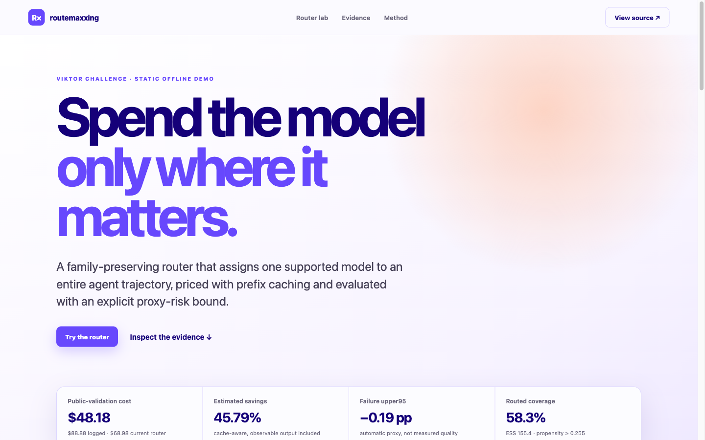
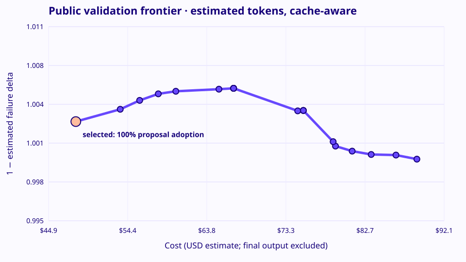

<div align="center">

# Routemaxxing

**Spend the expensive model only where it matters.**

A cost-aware LLM router for agent trajectories, with an honest off-policy evaluation:
cache-aware pricing, propensity-supported downgrades, and an explicit proxy-risk bound.

[](https://routemaxxing.vercel.app)
&nbsp;
[](#reproduce)
&nbsp;
[](#context)

<a href="https://routemaxxing.vercel.app"></a>

</div>

---

## Result

On a public validation split, the router cut estimated model spend by **45.8%**
with no detected rise in the failure proxy:

| | Estimated cost | Savings | Failure proxy Δ (upper 95%) | Routed coverage |
|---|---:|---:|---:|---:|
| Logged behavior | $88.88 | — | — | — |
| Prompt-size heuristic baseline | $74.68 | 16.0% | −0.01 pp | 29.5% |
| **Routemaxxing, certified** | **$48.18** | **45.8%** | **−0.19 pp** | **58.3%** |

The constraint was an upper bound of +2 percentage points on failure-proxy degradation.
The selected policy stays well inside it: its one-sided 95% upper bound is *negative*.
It also leaves no supported expensive default unrouted.

<p align="center"></p>

> **Honesty notes.** Tokens are estimated (serialized JSON chars / 4), not measured.
> The quality signal is an automatic failure proxy, not a human label. The numbers come
> from the public validation split, not an organizer-held-out set.

## The problem

You get an offline export of real agent trajectories (1,000 histories from a production
agent across ~9 Claude and GPT models). The export has **no outputs, no token usage, and no
quality labels**, and every trajectory shows only the model that actually ran.

Two questions follow. Which model should each task get? And how do you *prove* a different
choice would have been cheaper without being worse, when you never observe that choice?

## What we found

1. **The unit of analysis was wrong.** The 1,000 rows are not single requests. Each unfolds
   into a full history, and together they hold **10,845 model calls**. Grouping rows by
   opening text (the starter assumption) gives 953 groups, 19 of them mixed-model
   collisions, and badly undercounts spend.
2. **The two model families speak different tool dialects.** Claude histories use
   `bash`/`file_edit`; GPT histories use `shell_command`/`apply_patch`. They do not overlap,
   so a cross-family counterfactual has no support. The router only downgrades
   *within* a family.
3. **Switching models mid-task is expensive.** A provider's prompt cache is lost on every
   switch, so the next call pays full price for the whole prefix. The router picks one
   model per trajectory and prices that cache reset explicitly.

## How it works

- **Decides at call zero.** The policy sees only the opening task, trigger, toolset,
  initial context size, images, and named intent flags. It never sees future depth,
  errors, or outputs.
- **Proposes only supported downgrades.** It considers only strictly cheaper models within
  the same family that the logged data actually supports (minimum propensity and sample
  size). GPT Luna had 12 training trajectories, below the minimum of 20, so the certified
  router never picks it.
- **Ranks proposals by dollars saved per unit of risk.** Uses partially pooled savings
  estimates and an L2 logistic failure model trained only on the training split.
- **Evaluates off-policy.** Uses a 70/30 split grouped by thread identity,
  propensity-screened outcome regression, and 2,000 trajectory bootstrap replicates for the
  one-sided 95% bound.
- **Prices with caching.** Cost includes uncached input, cached prefix reads, and every
  observable output, and a switch resets the cache. Fixed-shape and behavior-adjusted
  costs are both reported.
- **Reports an adaptive variant separately.** A one-shot escalation policy runs only after
  observed tool errors or loops. Its result is conditional on the logged states, so it is
  kept out of the headline.

Full write-ups: [`ROUTEMAXXING.md`](ROUTEMAXXING.md) (certified policy and evaluation) and
[`ROUTER.md`](ROUTER.md) (earlier contextual-cost router, v2–v6).

## Known limitations

- Model assignment is observational. A different early model could have produced a
  different later context.
- The failure proxy covers unresolved tool errors and repeated-action loops. It does not
  measure task quality.
- No cross-family routing, because the data has no overlap to support it.
- All dollar figures are estimates from estimated tokens and the official price schedule.

## Reproduce

Python 3.10+ with the standard library only. The challenge dataset is not redistributable,
so it is not in this repo. A synthetic sample with the same shape is included:

```bash
python scripts/make_synthetic_sample.py      # writes ./export/ (or extract the real export there)
python scripts/routemaxxing.py export/       # ledgers, frontier, summary → results/routemaxxing/
python -m pytest -q
```

Interactive tools:

```bash
python scripts/build_live_demo.py            # aggregate-only data → docs/data.js
python -m http.server 4173 -d docs           # Router Lab at http://127.0.0.1:4173
python -m explorer                           # local trajectory explorer (needs the export)
```

The live demo ships only aggregate metrics: no prompts, tools, trajectories, or route ids.

## Repository map

| Path | What |
|---|---|
| `scripts/routemaxxing.py` | Certified router, off-policy evaluation, frontier |
| `scripts/routers/`, `scripts/baseline_router.py` | Earlier routers (heuristic baseline, learned, contextual-oracle) |
| `scripts/cost_model.py` | Cache-aware cost model and official price schedule |
| `scripts/load_trajectories.py` | Export loader and trajectory reconstruction |
| `docs/` | Static Router Lab, deployed to Vercel |
| `explorer/` | Local trajectory explorer (Python API and frontend) |
| `presentation-routemaxxing.html` | Six-slide hackathon deck ([PDF](presentation-routemaxxing.pdf)) |
| `tests/` | Pytest suite |

## Context

Built at the **TUM.ai hackathon** in Munich (22–23 Aug 2026) for the **Viktor Challenge:
Build the Router**. The repo started from the organizers' starter kit. The original
briefing is in [`AGENTS.md`](AGENTS.md), and the guided workflows are in `skills/`.

**Team:** Atahan Kılıç · Musa Kocabaşoğlu · Utku Kalkanlı
